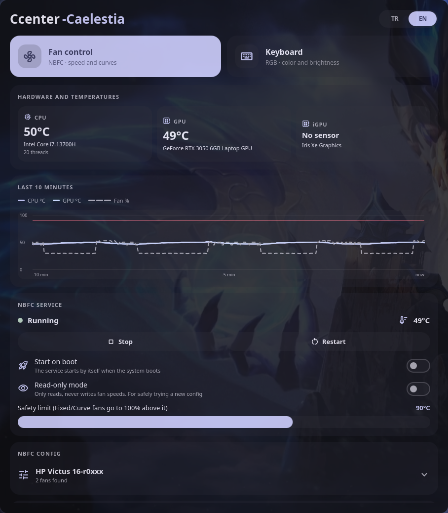
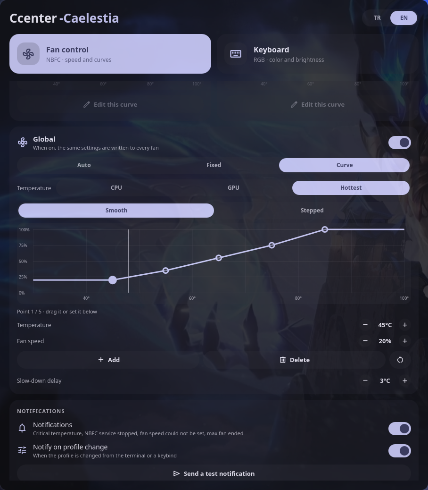
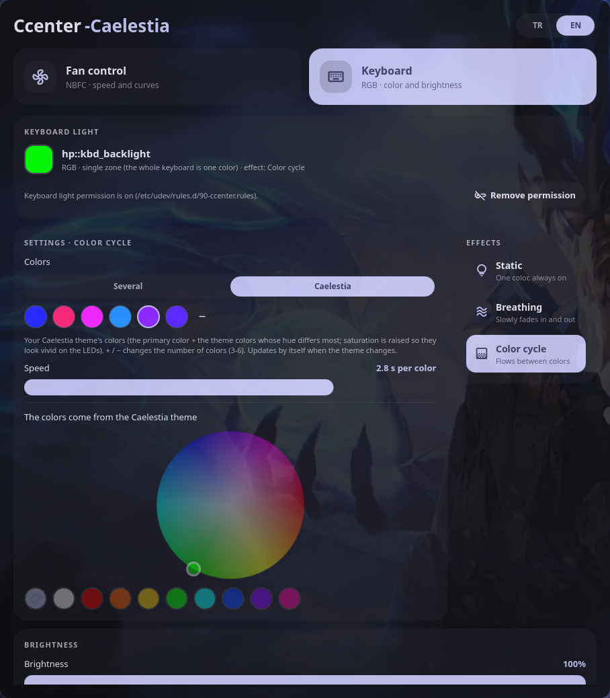
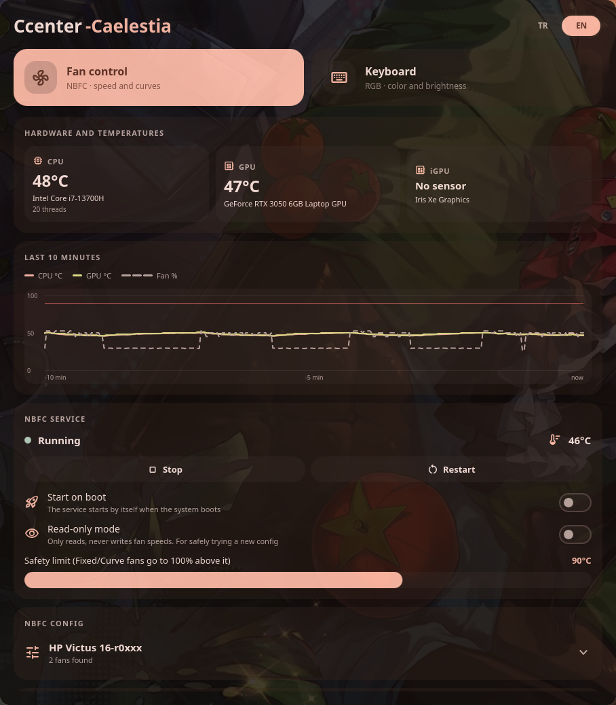
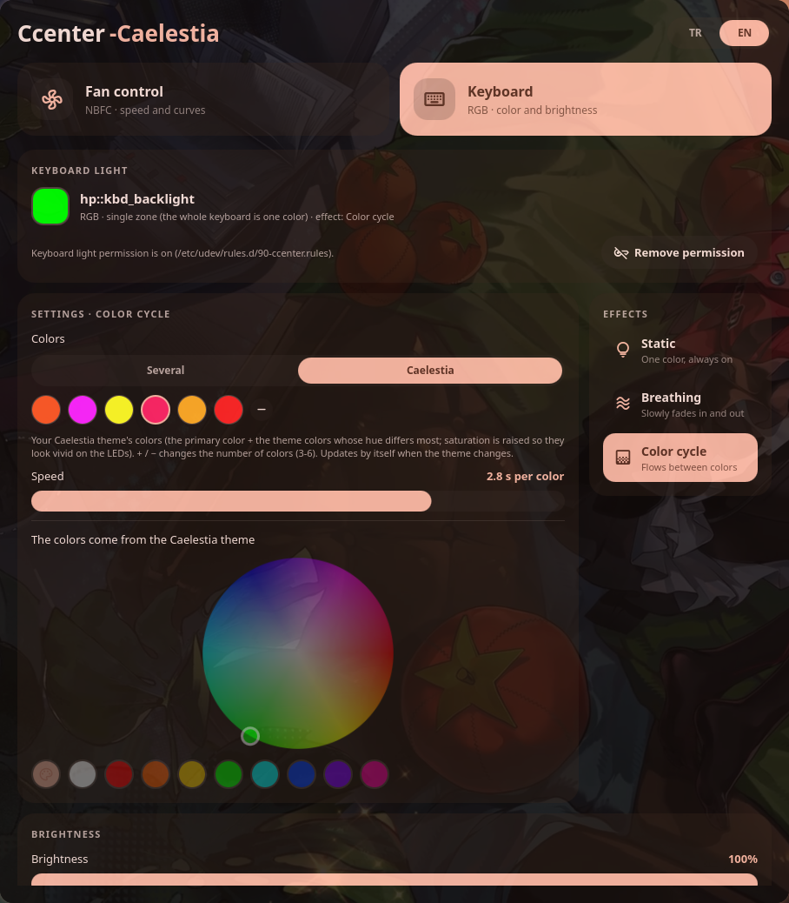

# Ccenter-Caelestia

A laptop control center for **fan control** and **keyboard lighting**, built with [Quickshell](https://quickshell.org) and themed to match [Caelestia dots](https://github.com/caelestia-dots).

> [!WARNING]
> **This project is in a very early stage. Use it at your own risk.**
>
> - **It has only been tested on one laptop: HP Victus 16-r0xxx** (i7-13700H, RTX 3050, Arch Linux, Hyprland). It has not been tried on other HP models or on laptops from other brands, and it may not work there.
>   - Fan control needs a working NBFC config for your exact model.
>   - Keyboard lighting has only been tested with the single-zone RGB backlight of HP's `hp-wmi` driver. Other keyboards (see the table below) were checked against the kernel's driver code and with simulated hardware, not on real laptops.
> - The fan section **writes fan speeds to your hardware** through NBFC. A wrong setting can make your laptop run hot. Keep an eye on temperatures.
> - In *Fixed* and *Curve* modes the app itself drives the fans. Closing the window keeps it running in the background; quitting it hands the fans back to NBFC. If the app is killed in another way, the fans **stay at the last speed it set**; run `nbfc set -a` to return them to automatic control.
> - Things will change and break without notice. The name is temporary too.

## Screenshots

| Fan control | Curve editor | Keyboard |
|---|---|---|
|  |  |  |

The colors follow your Caelestia theme. The same app with a different wallpaper:

| Fan control | Keyboard |
|---|---|
|  |  |

## Features

### Fan control (via NBFC-Linux)
- Live temperature, fan speed and service status
- Per-fan modes: **Auto**, **Fixed** (constant %), **Curve** (temperature → speed)
- Curve editor with draggable points, fine-tuning, smooth or stepped curves
- "Global" card that applies one setting to every fan
- Profiles: built-in (NBFC Auto, Quiet, Balanced, Performance) and your own saved ones
- Per-fan temperature source in Curve mode (CPU, GPU or the hotter one)
- Hysteresis and gradual slow-down in Curve mode, so fans don't keep revving up and down
- Shows your NBFC config's own fan curve and lets you copy it into an editable curve
- Max fan button (5 min, 15 min or until turned off)
- Last 10 minutes graph of CPU/GPU temperature and fan speed
- Desktop notifications through Caelestia: critical temperature, NBFC service stopped, fan speed could not be set, max fan ended, profile switched from a keybind (can be turned off)
- Real fan RPM when the driver reports it
- Tray icon in the Caelestia bar: click to show/hide, hover for profiles, max fan and quit
- Light on resources: ~0.5% CPU in the background when NBFC is in control
- Settings are saved in `~/.config/ccenter/settings.json`
- Safety limit: above 90 °C, fans in Fixed/Curve mode go to 100%
- NBFC service controls (start / stop / restart, read-only mode, start on boot) and config selection
- CPU, GPU and iGPU temperatures. A sleeping NVIDIA GPU is not woken up just to read its temperature.

### Keyboard lighting
- Change the keyboard **color** (color wheel, presets, or your Caelestia theme color) and **brightness**
- Detects your laptop and its keyboard light step by step (maker → kernel driver → light → permission → support level) and shows only what your keyboard can do. `ccenter kbd info` prints the same report (handy for bug reports)
- **Breathing effect**: the light fades in and out with your color, cycles through up to 6 colors of your choice, or uses your Caelestia theme colors (follows theme changes). Adjustable speed and lowest/highest level; with a lowest level above 0 the light never goes dark and the colors flow into each other. Keeps running when the window is closed and resumes after a restart
- **Color cycle effect**: the light flows smoothly between your colors (or the Caelestia theme colors) without dimming
- Caelestia colors: 3 to 6 colors taken from your current theme, picked so they look different from each other
- More effects (rainbow, …) are not there yet

#### Supported keyboards

Ccenter only uses the interfaces the **Linux kernel** provides for keyboard lights (`/sys/class/leds`). It never talks to the firmware, the embedded controller or USB devices directly, so the kernel driver checks every value.

| Laptop | Kernel light | What works in Ccenter |
|---|---|---|
| HP Victus / OMEN, single-zone RGB | `hp::kbd_backlight` (needs a recent kernel, 7.2+) | Color, brightness, effects (tested) |
| HP OMEN / Victus, four-zone RGB | `hp::kbd_zoned_backlight-*` | Color (same on all zones), brightness, effects (not tested on real hardware) |
| ASUS TUF with RGB | `asus::kbd_backlight` + `kbd_rgb_mode` | Static color and 4 brightness levels (not tested on real hardware). Never saves to the BIOS |
| ASUS (other) | `asus::kbd_backlight` | Brightness levels |
| ASUS ROG (Aura N-KEY) | colors are a USB device | Brightness only; colors: use [asusctl](https://gitlab.com/asus-linux/asusctl) |
| Lenovo IdeaPad / LOQ / ThinkPad | `platform::kbd_backlight` / `tpacpi::kbd_backlight` | Brightness levels |
| Lenovo Legion RGB | colors are a USB device (ITE) | Brightness if the kernel exposes it; colors: use [L5P-Keyboard-RGB](https://github.com/4JX/L5P-Keyboard-RGB) or [OpenRGB](https://openrgb.org) |
| HP per-key RGB | not supported by the kernel | — |

Software effects (breathing, color cycle) write to the light many times per second, so they are only enabled on the HP driver they were tested with.

### Languages
- The interface is available in **English** and **Turkish**. Switch with the **TR / EN** button in the window header (or `ccenter lang en`); the change applies right away.
- By default it follows your system language (Turkish if your locale is `tr_*`, English otherwise). Your choice is saved.
- Terminal commands, notifications, the tray menu and `install.sh` / `uninstall.sh` follow the same language.
- Built-in profile names work in any language from the terminal (`quiet`, `Quiet` and `Sessiz` all apply the same profile).

### Caelestia integration
- Colors follow Caelestia's scheme (`~/.local/state/caelestia/scheme.json`) live.
- Rounding, spacing, fonts, animations and transparency come from your Caelestia shell settings, so the app looks like the rest of your shell. With Hyprland blur enabled, the window is blurred like Caelestia's panels.
- Ccenter only **reads** Caelestia files and never modifies them.

## Installation

### 1. Requirements

If you already use [Caelestia dots](https://github.com/caelestia-dots), the first three are most likely installed.

| Needed | Why | Arch Linux package |
|---|---|---|
| [Quickshell](https://quickshell.org) (0.3.x) | the toolkit the app runs on | `quickshell` / `quickshell-git` (AUR) |
| [Caelestia shell](https://github.com/caelestia-dots/shell) | design tokens and colors; Ccenter **will not start without it** | `caelestia-shell` (AUR) |
| [Material Symbols](https://fonts.google.com/icons) font | icons | `ttf-material-symbols-variable` |
| [NBFC-Linux](https://github.com/nbfc-linux/nbfc-linux) with a config for your laptop | fan control (see step 2) | `nbfc-linux` (AUR) |
| A polkit agent | the password dialog for admin actions (Caelestia/Hyprland setups usually have one) | e.g. `hyprpolkitagent` |
| Optional: `python-gobject` | tray icon in the Caelestia bar | `python-gobject` |
| Optional: `nvidia-smi`, `lspci` | NVIDIA GPU temperature, GPU names | `nvidia-utils`, `pciutils` |

### 2. Set up NBFC (fan control)

Ccenter does not drive the fans by itself: it tells **NBFC-Linux** what to do, and NBFC talks to your laptop's embedded controller. So NBFC needs a working config for your laptop first. Full instructions: **[NBFC-Linux README](https://github.com/nbfc-linux/nbfc-linux#readme)**.

```sh
yay -S nbfc-linux                      # Arch (AUR). Other distros: see the NBFC-Linux README
sudo nbfc update                       # download the latest laptop configs
nbfc config -r                         # list configs that may fit your laptop
sudo nbfc config -s "<config name>"    # pick one (or: sudo nbfc config -s auto)
sudo nbfc start --read-only            # try it safely first: reads only, never writes fan speeds
nbfc status -a                         # fans and temperature look right?
sudo nbfc restart                      # then run it normally
sudo systemctl enable nbfc_service     # start NBFC on boot
```

If no config fits your laptop, **don't force one**: a wrong config can make the fans behave badly. Without NBFC the keyboard part of Ccenter still works. You can also pick and try configs later from Ccenter (Fan tab > NBFC config, with read-only mode).

### 3. Install Ccenter

```sh
git clone https://github.com/kerimozgurtukenmez/Ccenter-Caelestia.git
cd Ccenter-Caelestia
./install.sh
```

Then start **Ccenter** from your app launcher, or run `ccenter`.

**No `sudo` needed.** `install.sh` installs into your own home folder and shows the exact plan before it writes anything. Everything optional is asked separately:

| What | Where |
|---|---|
| App, `ccenter` command and icon | `~/.local/share/ccenter/` (the command is `~/.local/share/ccenter/bin/ccenter`) |
| Launcher entry | `~/.local/share/applications/ccenter.desktop` |
| Background service (off until you enable it) | `~/.local/share/systemd/user/ccenter.service` (or `~/.config/systemd/user/`) |
| Short `ccenter` command | `~/.local/bin/ccenter`, a link to the command above |
| `ccenter` in your `PATH` (only if it isn't already, asked) | a small marked block in `~/.bashrc` / `~/.zshrc`, or `~/.config/fish/conf.d/ccenter.fish` |
| Keyboard light permission (optional, asked, default no) | `/etc/udev/rules.d/90-ccenter.rules` (the only step that asks for your password, see below) |

To update later: `git pull`, quit Ccenter (`ccenter quit`) and run `./install.sh` again. Your settings are kept.

Everything lives in the app's own folder; the other entries are only added where they can be. If a folder is not writable (for example `~/.local/bin` owned by root because something was once installed there with `sudo`), or a file with the same name belongs to another program, that entry is skipped and the installer tells you why. Nothing of yours is overwritten and you never have to change permissions.

The app writes its settings to `~/.config/ccenter/settings.json`, and only after you change something.

### Permissions: asked, never taken silently

- **Keyboard light (optional).** To change the keyboard color and brightness, Ccenter needs write access to the keyboard light's own files (`brightness`, and the color file: `multi_intensity` or, on ASUS TUF, `kbd_rgb_mode`). `install.sh` explains what this does and **asks** you; the default answer is no. Only if you say yes, your password is asked for that single step, which adds `/etc/udev/rules.d/90-ccenter.rules`. You can also grant it later from the Keyboard tab (the "Grant permission" button; your password is asked by the system's own dialog) and remove it there again ("Remove permission"). The rule makes **only your user** the owner of those files: other users of the computer get nothing, and it gives no access to fans, files or the system. (Versions before 0.3 made the files writable for every user; the app and `install.sh` offer to replace that rule with the per-user one.)
- **NBFC service actions** (start/stop/restart the fan service, apply a config) ask for your password through polkit every time you use them. Setting fan speeds does not need a password.

### Uninstall

```sh
./uninstall.sh
```

It shows what it will delete (including only Ccenter's own `PATH` block in your shell startup files), quits Ccenter (keyboard back to your static color, fans back to NBFC) and asks separately whether to remove the keyboard permission and whether to keep your settings.

### Packaging / system-wide install

The `Makefile` is for packagers (`make DESTDIR=… PREFIX=/usr install`) or a system-wide install with `sudo make install`. It never adds the keyboard permission on its own; that is a separate, optional `sudo make udev`.

### Running in the background
- Closing the window does **not** quit Ccenter; it keeps controlling the fans in the background. Open it again from the launcher, the tray icon or with `ccenter`.
- To quit completely, use the "Quit" button in the app, the tray menu or `ccenter quit`. Fans that Ccenter was controlling are handed back to NBFC's automatic control first.
- "Start in background on login" in the app enables the systemd user service. Stopping the service quits Ccenter the same way as "Quit" (keyboard effect back to your static color, fans back to NBFC); if it crashes, fans are still handed back to NBFC (`nbfc set -a`).
- Only one copy of Ccenter runs at a time. `ccenter` refuses to start a second copy, because two copies would fight over the fans.

### Terminal control

```sh
ccenter                     # open the window (starts the app if needed)
ccenter status              # fans, temperatures, active profile
ccenter profiles            # list profiles (* = active)
ccenter profile quiet       # apply a profile (case-insensitive; built-ins: auto, quiet, balanced, performance)
ccenter boost 15            # max fan for 15 minutes (0 = off, -1 = until turned off)
ccenter kbd color "#ff0000" # keyboard color
ccenter kbd brightness 50   # keyboard brightness in percent (0 = off)
ccenter kbd effect cycle    # keyboard effect: static | breathing | cycle
ccenter kbd source theme    # breathing colors: single | multi | theme (Caelestia)
ccenter kbd speed 60        # effect speed 0-100
ccenter kbd range 20 80     # breathing lowest and highest level in percent
ccenter kbd themecount 5    # number of Caelestia colors (3-6)
ccenter kbd info            # keyboard detection report: laptop, driver, light, permission, support
ccenter report              # diagnostic report for bug reports (see "Reporting a problem")
ccenter lang en             # interface language: en | tr
ccenter hide                # also: open, toggle
ccenter quit                # quit; fans go back to NBFC auto
ccenter --help
```

Handy for Hyprland keybinds, e.g. `bind = SUPER, F9, exec, ccenter profile performance`.

The window uses the app ID `ccenter`, so you can target it in Hyprland rules with `class:^(ccenter)$`.

## Reporting a problem

Something not working? Create a diagnostic report and attach it to a [GitHub issue](https://github.com/kerimozgurtukenmez/Ccenter-Caelestia/issues):

```sh
ccenter report        # or: ~/.local/share/ccenter/bin/ccenter report, or ./bin/ccenter report in the cloned folder
```

or press **Create report** at the bottom of the Fan or Keyboard tab. It works even if Ccenter doesn't start.

The report is one text file in your home folder (`~/ccenter-report-<date>.txt`). It contains: Ccenter, system and package versions, the laptop model (no serial numbers), NBFC status and config, temperature and keyboard detection output, the keyboard permission rule, your Ccenter settings, the background service journal and the logs of the last Ccenter runs (also runs that crashed; these logs are kept until you reboot, so create the report before rebooting). Your home folder, user name and computer name are replaced with `~`, `<user>` and `<host>`. Nothing is sent anywhere: read it, and share what you are comfortable with.

## Reverting changes

- Return fans to NBFC's automatic control: `nbfc set -a`
- Ccenter never edits NBFC config files. It only changes which config is selected. To go back to a config of your choice: `sudo nbfc config --set "<config name>"` followed by `sudo nbfc restart`
- Remove the app: `./uninstall.sh` (see above)
- Remove only the keyboard permission: Keyboard tab > "Remove permission" (or `sudo rm /etc/udev/rules.d/90-ccenter.rules` and reboot)

## How it works (behind the scenes)

Ccenter is **one Quickshell process** that keeps running in the background. The window is only a view: it is created when you open it and destroyed when you close it (to save memory), while the logic in `services/` keeps going.

```
            ┌──────────── Ccenter (one Quickshell process) ────────────┐
 you ──► window (QML, only while open) ──► services/ (always running)  │
 terminal ─ ccenter <cmd> ─(IPC)─────────►  FanState  Nbfc  Sensors    │
 tray ─ scripts/tray.py ─────────────────►  Keyboard  Alerts Settings  │
            └──────────────┬─────────────────────┬───────────────────────┘
                           │                     │
          nbfc status / nbfc set          /sys/class/hwmon (read)
          (NBFC service → EC → fans)      /sys/class/leds (keyboard)
```

**Fans.** Every 2 seconds (5 seconds when the window is closed and NBFC is in control) Ccenter reads `nbfc status -a`: fans, temperature, speeds. In *Auto* mode it only shows what NBFC does. In *Fixed* and *Curve* modes Ccenter computes the speed itself and sends it with `nbfc set -f <fan> -s <percent>`:

1. Take the temperature (CPU from NBFC, GPU from the sensors, or the hotter one).
2. Look it up on your curve (smooth or stepped).
3. Speed up right away, but slow down only after the temperature has dropped a few degrees below the curve, and then at most 5% every 2 seconds (no constant revving).
4. Above the safety limit (90 °C by default, CPU or GPU, whichever is hotter) every fan Ccenter controls goes to 100%, skipping all of the above.

Quitting ("Quit", `ccenter quit`, the tray menu) first hands the fans back to NBFC (`nbfc set -a`). The background service also does that if Ccenter crashes (`ExecStopPost`).

**Temperatures.** `scripts/sensors.sh` reads the kernel's hardware sensors (`/sys/class/hwmon`: CPU package, iGPU, AMD GPU) using shell built-ins only, so a reading costs about 10 ms. The NVIDIA driver doesn't expose its temperature there, so `nvidia-smi` is called, but only while the GPU is already awake (a sleeping GPU is never woken up) and less often while the window is closed.

**Keyboard.** `scripts/kbdinfo.sh` (read only) finds the laptop maker, the kernel driver and the keyboard light, and Ccenter picks a matching backend (see *Supported keyboards*). Changes are written to the light's files in `/sys/class/leds` by one long-running `awk` process, so effects (up to 25 frames per second) don't start a new process for every frame.

**Settings.** One file, `~/.config/ccenter/settings.json`, written atomically (never half-written) and only after you change something. Fan settings are stored per NBFC config, so a setting is never applied to the fans of a different config. Every value read from the file is checked and clamped.

**Cost.** About 0.5% CPU in the background while NBFC is in control, about 2% with a curve or with the window open; about 55–75 MB of memory with the window closed, about 90 MB open (plus ~30 MB for the tray icon).

### Security

- **Normal use needs no admin rights.** Fan speeds go through NBFC's own client (`nbfc set`), which doesn't need root.
- **Admin actions only when you click them,** through the system's password dialog (`pkexec`): starting/stopping/restarting the NBFC service, applying an NBFC config, granting or removing the keyboard permission. Ccenter never sees your password.
- **Keyboard: only the kernel's own interfaces.** No raw firmware (WMI/ACPI), embedded controller or USB access; the kernel driver checks every value. On ASUS the "save to BIOS" command is never used. Software effects run only on the driver they were tested with.
- **The keyboard permission is for your user only.** The udev rule makes your user the owner of the light's brightness/color files; other users get nothing, the permission bits don't change, and no shell is run. Before the rule is installed as root it is rendered into a root-owned file and checked line by line (`scripts/kbd-rule-check.sh`): anything other than the expected `chown` lines is refused and nothing changes.
- **Never written:** NBFC config files (only which config is selected changes, through `nbfc config`), Caelestia's files (`~/.config/caelestia`, `~/.local/state/caelestia`, Hyprland config: read only).
- **Trust boundary:** Ccenter is installed in your home folder and runs as your user, so anything already running as your user could change it. Admin actions still always need your password in the system dialog.

## How it was tested

Everything was developed and tested on one machine: **HP Victus 16-r0xxx** (i7-13700H, RTX 3050 Laptop + Iris Xe), Arch Linux, kernel 7.2, Hyprland + Caelestia.

- **Fans:** every mode, profile and the max fan button, driven through the terminal commands (`ccenter profile …`, `ccenter status`) and checked against `nbfc status`. Curve logic (hysteresis, gradual slow-down, safety limit) reviewed on the live system.
- **Interface:** both languages, every tab and card, checked with screenshots; clicks and scrolling automated (`ydotool`, cursor position read back from Hyprland).
- **Resources:** CPU time from `/proc/<pid>/stat` and memory (PSS) from `smaps_rollup`, with the window open and closed; a one-hour run showed no leaks (threads, open files and memory stayed flat).
- **Keyboard on real hardware (HP single-zone RGB):** every color, brightness and effect written and read back from `/sys/class/leds/hp::kbd_backlight`; effect frames sampled to make sure no wrong-colored frame is shown.
- **Other keyboards, simulated:** fake `/sys` trees for an ASUS TUF, an HP four-zone OMEN, a Lenovo IdeaPad with a Legion USB RGB controller and an ASUS ROG (N-KEY). The detection report and every value written were checked. **Not tested on real ASUS, Lenovo or HP four-zone laptops** — reports are very welcome.
- **Keyboard permission:** rule syntax checked with `udevadm verify`; the rule checker rejects tampered rules (extra commands, wrong user, missing lines); the exact grant command was dry-run with a throwaway folder in place of `/etc`; then granted for real on the development machine (files owned by the user, still `0644`).
- **Installer:** `install.sh` / `uninstall.sh` run in a throwaway home folder (including unwritable folders and files of other programs); uninstall leaves nothing behind and removes only its own `PATH` block.
- **Not tested:** the critical temperature notification (the laptop can't be heated to 90 °C safely), other distros than Arch.

## Development

Run it straight from the cloned folder without installing:

```sh
./bin/ccenter
```

`bin/ccenter` uses the folder it lives in, so the same commands work (`./bin/ccenter status`, …). Quit the installed copy first; only one copy can run at a time. Keyboard permission works the same way (Keyboard tab > "Grant permission"). Quickshell reloads the UI live when you save a file.

### Notes for contributors and forks

- **Architecture:** the logic lives in `services/` (singletons that keep running when the window is closed); `modules/` is only the view and talks to the services. Fan settings have one source of truth, `services/FanState.qml`; the fan cards display it and report changes back. The window is created only while it is open (`LazyLoader` in `shell.qml`) to keep the background footprint small.
- **Style:** sizes, spacing, fonts and animations come from Caelestia (`Tokens.*`, `StyledText`, `Anim`/`CAnim`), colors from `services/Colours.qml`. Avoid hard-coded values so the app keeps matching the user's shell.
- **Text and translations:** write UI text in English and wrap it: `I18n.t("Fan %1").arg(n)`. Then add the Turkish line to `services/translations.js` (the key is the exact English text). Missing translations fall back to English. To add a language, add a block to `translations.js` and an entry to `I18n.languages` in `services/I18n.qml`. Shell scripts use a small `t "English" "Türkçe"` helper instead.
- **Performance:** the app runs in the background all the time. `scripts/sensors.sh` runs every few seconds, so it only uses shell built-ins; heavy bindings are skipped while the window is hidden (`Nbfc.uiVisible`).
- **Safety:** never write NBFC config files and never touch Caelestia's files (read only). Anything that changes the system must be opt-in and have a way to undo it.
- Test without clicking through the UI with the terminal commands (`./bin/ccenter status`, `profile …`, `kbd …`, `kbd info`).
- **Testing keyboards you don't have:** build a fake `/sys` tree (`sys/class/dmi/id/*`, `sys/class/leds/<light>/{brightness,max_brightness,…}`, `sys/class/leds/<light>/device/driver` → a folder named after the driver) and start with `CCENTER_SYS=<that folder> XDG_CONFIG_HOME=<a test folder> ./bin/ccenter`. Detection then reads, and the app writes, only that fake tree; the separate config folder keeps your real settings untouched.

## Project layout

```
shell.qml           window, tabs, terminal commands (IPC), tray wiring
services/           always-running backends: NBFC, fan state, keyboard, settings, sensors, colors, notifications, tray
services/I18n.qml   UI language; translations in services/translations.js
modules/fan/        fan tab (UI only)
modules/keyboard/   keyboard tab
components/         shared UI components
utils/              helpers
scripts/            sensors.sh (temperatures), hwinfo.sh (CPU/GPU names), kbdinfo.sh (keyboard detection),
                    kbd-rule-check.sh (checks the keyboard permission rule), report.sh (diagnostic report),
                    tray.py (tray icon)
assets/             icons and images used by the app
docs/screenshots/   README images (not installed)
bin/ccenter         launcher and terminal commands
dist/               desktop entry, systemd user service, keyboard permission rule template
install.sh          install into ~/.local (no sudo; asks about the keyboard permission)
uninstall.sh        remove it again
Makefile            system-wide install / packaging
LICENSE             GPL-3.0
```

## Status / roadmap

- [x] Fan control through NBFC
- [x] Persist per-fan settings across restarts
- [x] Profiles, background mode, tray icon, notifications
- [x] Installation without sudo (`./install.sh`), permissions only when you agree
- [x] Keyboard color and brightness
- [x] Keyboard breathing effect (one color, several colors or Caelestia theme colors)
- [x] Keyboard color cycle effect
- [x] Keyboard detection (HP, ASUS, Lenovo) with a step-by-step report; per-user keyboard permission
- [ ] Test on real ASUS / Lenovo / HP four-zone laptops (help wanted)
- [ ] Separate colors per zone on HP four-zone keyboards; ASUS TUF hardware effects (once tested)
- [ ] More keyboard effects (rainbow, …)
- [ ] Keep the keyboard color in sync with the Caelestia theme automatically (one-click theme color is already there)
- [x] English and Turkish UI

Issues and feedback are welcome, but expect rough edges.

## Acknowledgements

Ccenter is built on top of other people's open-source work. Many thanks to the developers of:

- **[Caelestia](https://github.com/caelestia-dots)**, the shell and dots this app is made for. Its colors, design tokens and overall look come from there.
- **[Quickshell](https://quickshell.org)**, the toolkit the whole app is built with.
- **[NBFC-Linux](https://github.com/nbfc-linux/nbfc-linux)**, which does the actual fan control, and its contributors, whose laptop configs make fan control possible on so many machines.
- **[Material Symbols](https://fonts.google.com/icons)**, the icons used throughout the app.

## License

Copyright (C) 2026 Kerim Özgür Tükenmez

Ccenter is free software: you can redistribute it and/or modify it under the terms of the **GNU General Public License version 3** as published by the Free Software Foundation. It is distributed in the hope that it will be useful, but **without any warranty**; without even the implied warranty of merchantability or fitness for a particular purpose. See [`LICENSE`](LICENSE) for the full text.

Third-party parts:

- **[Caelestia shell](https://github.com/caelestia-dots/shell)** (GPL-3.0): Ccenter imports its QML plugin at runtime, and the transparency maths in `services/Colours.qml` is adapted from Caelestia's `Colours.qml`. Caelestia is not bundled.
- **[Quickshell](https://quickshell.org)** (LGPL-3.0), **[nbfc-linux](https://github.com/nbfc-linux/nbfc-linux)** (GPL-3.0) and the **[Material Symbols](https://fonts.google.com/icons)** font (Apache-2.0) are used as separate programs or system fonts; they are not included in this repository.

Ccenter is made for Caelestia users, but it is an independent project: it is not made, endorsed or supported by the Caelestia, Quickshell or NBFC developers, or by any laptop vendor. Please report problems with Ccenter here, not to them.
